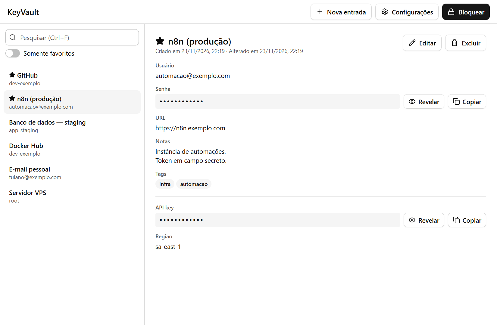
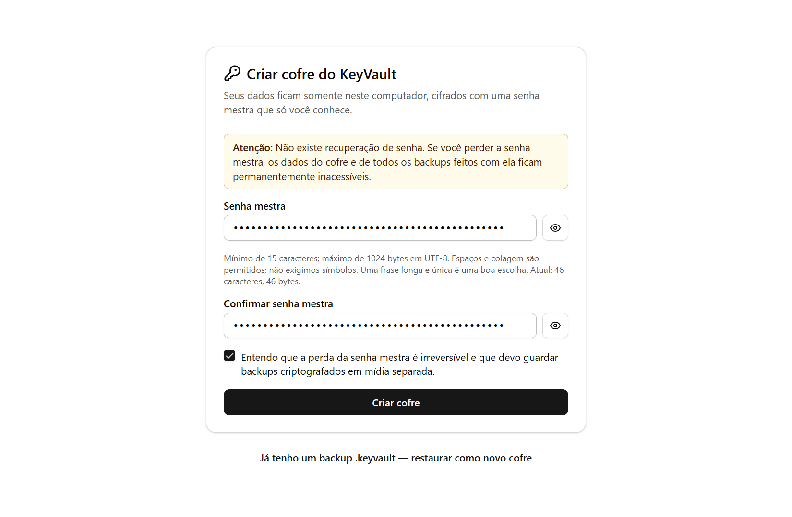
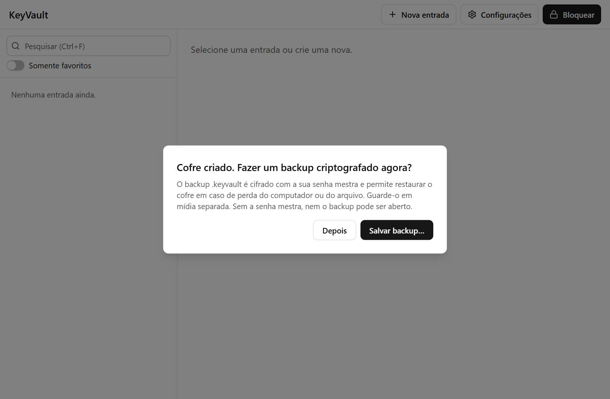
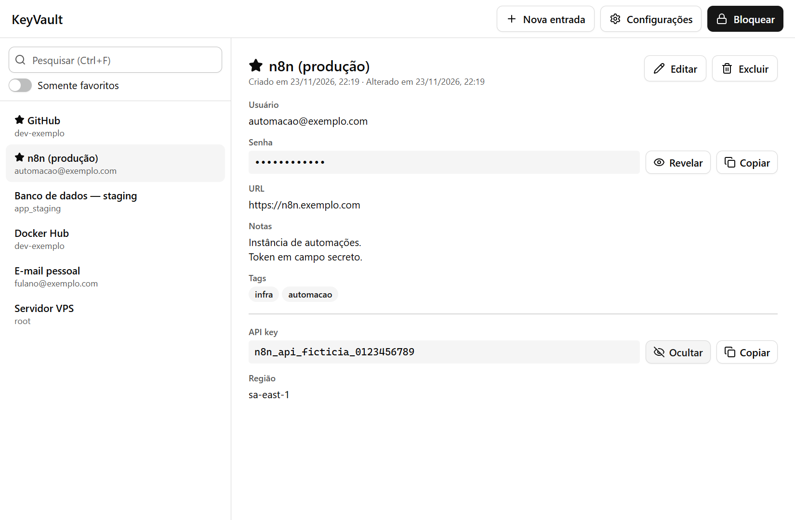
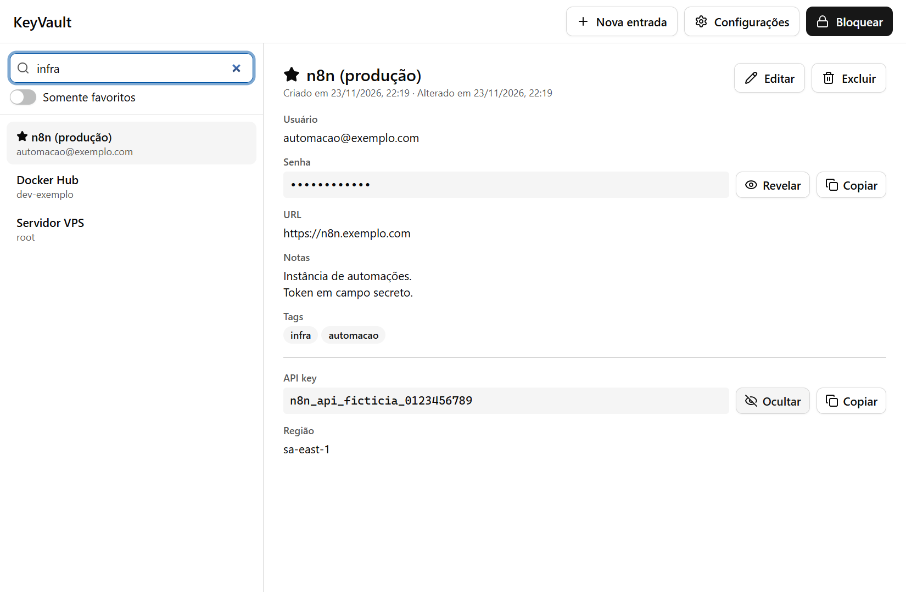
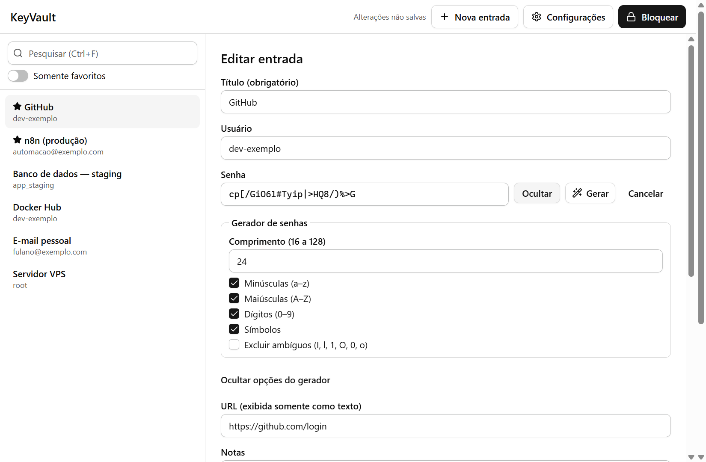
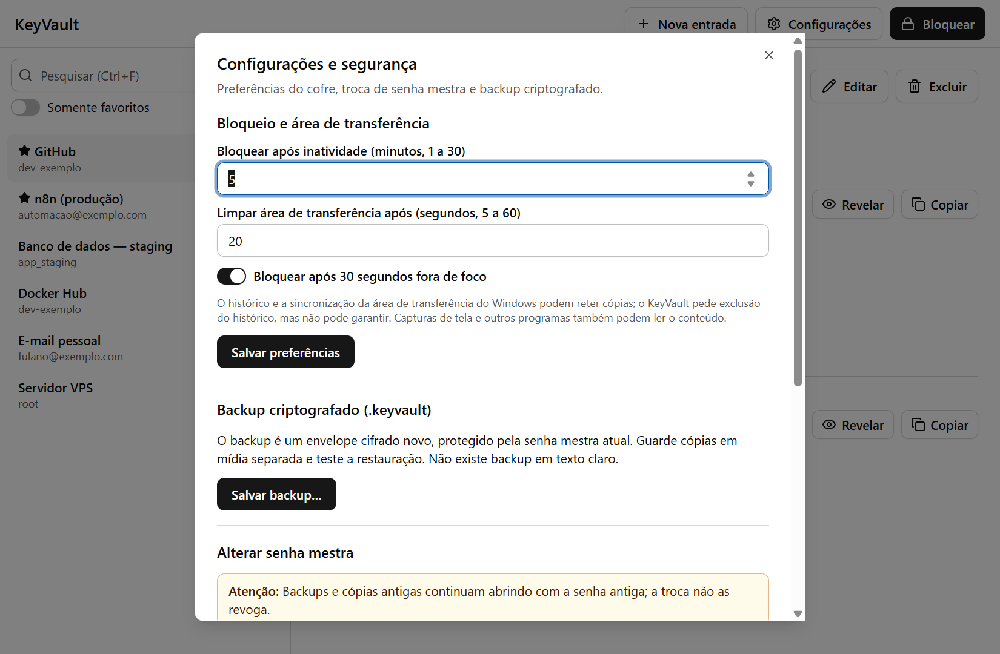
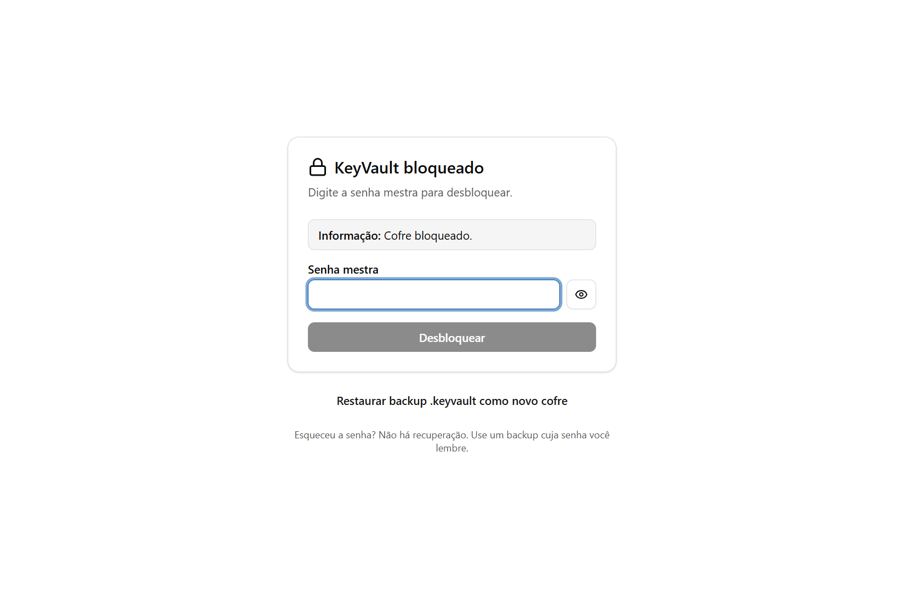
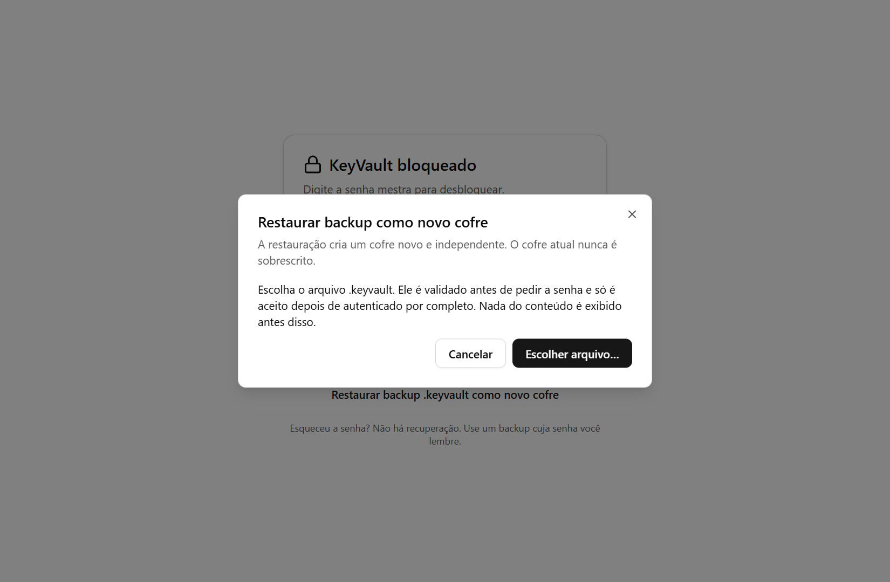

# KeyVault

Gerenciador de senhas **desktop, local e offline**, com interface em português do Brasil. Implementação da
especificação [KEYVAULT.md](KEYVAULT.md) (versão 1.0). Primeira plataforma homologada: **Windows**
(macOS/Linux não são declarados suportados).

> **Aviso.** Esta versão (0.1.0) é resultado de desenvolvimento e verificação pelo próprio implementador.
> A revisão de segurança independente exigida pela especificação **não foi realizada**. Não use para guardar
> credenciais reais de produção antes dessa revisão. Não há recuperação de senha.

Stack: Tauri 2.12 · Rust 1.100 · React 19 · TypeScript 6 (strict) · Vite 8 · Tailwind CSS 4 · shadcn/ui ·
SQLite (rusqlite/bundled) · Argon2id + AES-256-GCM (RustCrypto).



## Telas

Capturas do app instalado (build de produção) com dados **fictícios**, geradas por
`e2e/run-screenshots.ps1`.

| | |
| :---: | :---: |
| <br>**Primeiro uso** — senha mestra de 15+ caracteres e aviso de perda irreversível | <br>**Backup oferecido** logo após a criação |
| <br>**Revelação temporária** (até 15 s; remascara ao perder o foco) | <br>**Pesquisa** em título, URL, usuário, tags e notas (nunca em segredos) |
| <br>**Editor** com gerador seguro no Rust (16–128 caracteres) | <br>**Configurações**: bloqueio, clipboard, backup e troca de senha |
| <br>**Bloqueado** — manual, inatividade, foco, sessão/suspensão do Windows | <br>**Restauração** sempre como cofre novo e independente |

## Documentação

- [docs/format.md](docs/format.md) — formato binário do envelope, AAD, limites e vetores de integração
- [docs/threat-model.md](docs/threat-model.md) — ativos, fronteiras, ameaças e limites
- [docs/security.md](docs/security.md) — decisões de segurança, IPC (DTOs/estados/erros), CSP, sessão, assinatura
- [docs/testing.md](docs/testing.md) — matriz de testes da seção 11 e como executar
- [docs/validation-report.md](docs/validation-report.md) — relatório de validação (o que foi executado e resultados)
- [docs/dependencies.md](docs/dependencies.md) — inventário de dependências, auditoria e licenças

## Pré-requisitos (Windows 10/11 x64)

- Rust stable (MSVC) — testado com rustc 1.100.0 (`winget install Rustlang.Rustup`)
- Visual Studio Build Tools com a carga "Desenvolvimento para desktop com C++" (MSVC + Windows SDK) —
  testado com Build Tools 2026 (MSVC 14.52, SDK 10.0.26100)
- Node.js 24 + npm 11
- WebView2 Runtime (já presente no Windows 11)

## Instalação das dependências

```powershell
npm ci
```

As crates Rust são baixadas pelo `cargo` na primeira compilação (versões fixadas em `src-tauri/Cargo.lock`).

## Desenvolvimento

```powershell
npm run tauri dev
```

O servidor Vite/HMR (porta 1420) e a `devCsp` existem somente em desenvolvimento.

## Verificações

```powershell
npm run format:check
npm run lint
npm run typecheck
npm test
cd src-tauri; cargo fmt --all --check; cargo clippy --workspace --all-targets; cargo test --workspace
```

Detalhes (incluindo testes que usam o clipboard real e o E2E do app instalado) em
[docs/testing.md](docs/testing.md).

## Build de produção

```powershell
npm run tauri build
```

Saídas: `src-tauri/target/release/keyvault.exe` e os instaladores em
`src-tauri/target/release/bundle/nsis/` e `.../msi/`. Os instaladores desta entrega **não são assinados**;
veja as instruções de assinatura em [docs/security.md §9](docs/security.md).

## Uso

1. **Primeiro uso**: crie o cofre com uma senha mestra de pelo menos 15 caracteres (máximo de 1.024 bytes
   UTF-8; espaços e colagem permitidos; os bytes são usados exatamente como digitados). Confirme que entende
   que a perda é irreversível. Em seguida, faça um backup.
2. **Desbloquear**: digite a senha. Erros mostram sempre "Não foi possível desbloquear: senha incorreta ou
   cofre inválido", com atraso progressivo (até 30 s).
3. **Entradas**: título, usuário, senha, URL (exibida como texto), notas, tags, favorito e campos
   personalizados (com opção "segredo"). Pesquisa em título, URL, usuário, tags e notas (nunca em senhas ou
   segredos), com filtro de favoritos. Atalhos: Ctrl+F pesquisa, Ctrl+N nova entrada, Ctrl+L bloquear.
4. **Segredos**: ficam mascarados; "Revelar" mostra por até 15 s e remascara ao perder o foco. "Copiar" é
   feito no Rust (o segredo não volta para a interface); a área de transferência é limpa após 20 s (5–60)
   somente se ainda contiver o que foi copiado — conteúdo novo seu é preservado.
5. **Gerador**: 24 caracteres por padrão (16–128), classes configuráveis, opção de excluir ambíguos.
6. **Bloqueio**: manual, após 5 min sem atividade (1–30), após 30 s fora de foco (desativável), ao bloquear
   a sessão do Windows, suspender, trocar de usuário, encerrar a sessão ou fechar o app.
7. **Excluir**: com confirmação; não há lixeira.

## Onde ficam os dados

- Cofres: `%LOCALAPPDATA%\com.keyvault.desktop\vaults\<id>.kvdb` (+ `-wal`, `-shm`, `.lock`), com ACL
  restrita ao seu usuário. Somente o envelope cifrado fica no banco; metadados técnicos (id do cofre,
  revisão, parâmetros KDF, tamanhos, datas de arquivo) são públicos — o arquivo SQLite **não** é cifrado
  por inteiro.
- Perfil do WebView2: `%LOCALAPPDATA%\com.keyvault.desktop\EBWebView\` (o app não guarda dados nele; a
  janela usa modo InPrivate).
- O app não grava logs e seu código não faz requisições de rede. Atenção: medimos que o **runtime
  WebView2** da Microsoft (processo filho do app) abre conexões HTTPS com a Microsoft na inicialização,
  fora do controle do app — detalhes e opções em [docs/security.md §7](docs/security.md).

## Riscos e limites (resumo)

- **Perda da senha mestra = perda dos dados.** Não há recuperação, nem pelo desenvolvedor.
- Senha fraca pode ser quebrada offline por quem copiar o arquivo; use uma frase longa e única.
- Malware no seu usuário, administrador, keylogger ou leitura de memória com o cofre desbloqueado não são
  isolados. A senha mestra fica na memória do processo enquanto o cofre está desbloqueado (necessário para
  gerar chaves novas a cada salvamento).
- Histórico/sincronização da área de transferência, capturas de tela e outros programas podem reter cópias.
- Um backup ou banco antigo completo pode ser reapresentado (replay) sem detecção confiável.
- Exclusões não apagam fisicamente versões antigas (SSD, backups antigos).

## Backup e restauração

- **Backup**: Configurações → "Salvar backup…". Gera um arquivo `.keyvault` novo, cifrado com a senha mestra
  **atual** (nunca em texto claro), escrito em um temporário privado e publicado de forma atômica. Salve ou
  descarte edições pendentes antes. Guarde cópias em mídia separada e **teste a restauração**.
- **Restaurar**: na tela de desbloqueio (ou no primeiro uso) → "Restaurar backup .keyvault como novo
  cofre". Escolha o arquivo, digite a senha **com que o backup foi criado**, confira a quantidade de
  entradas e defina uma nova senha mestra. Um cofre novo e independente é criado; o atual nunca é
  sobrescrito. Depois, selecione-o na tela de desbloqueio.
- **Troca de senha**: exige a senha atual. Backups antigos continuam abrindo com a senha antiga e não podem
  ser revogados — destrua-os se necessário e faça um backup novo.
